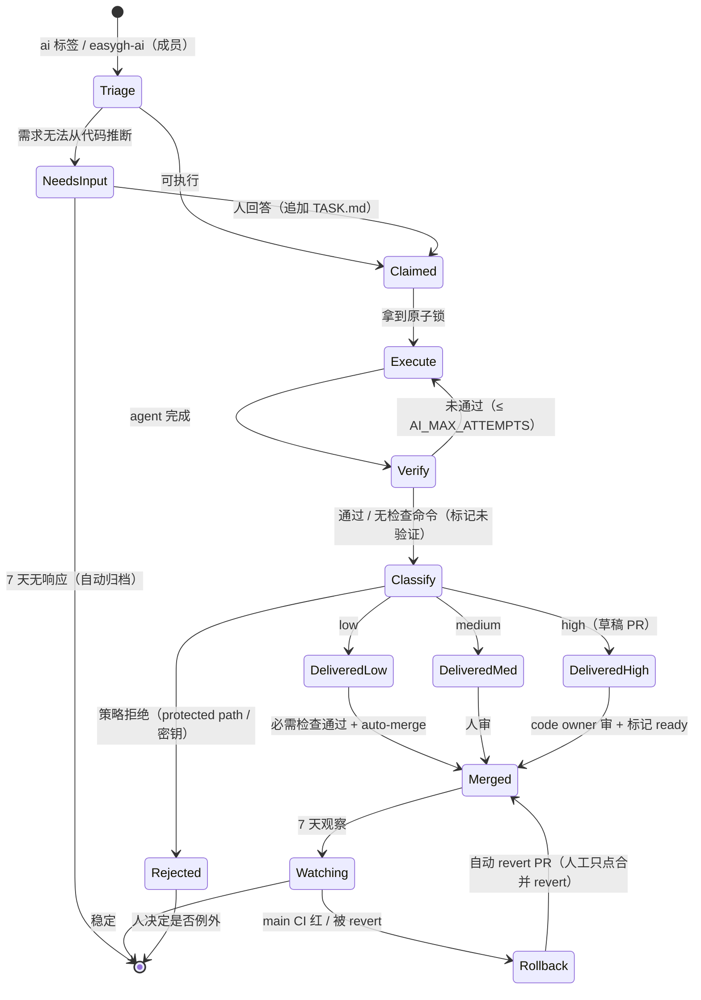

# AI 开发工作流（端到端设计）

> 目标：**默认自动化，人类只在"不可逆 / 改信任边界 / 产品意图"三类问题上出现**。
> 本文是工作流的单一事实来源（single source of truth）；实现状态在文末「落地路线」维护。

## 1. 设计原则

1. **默认自动，例外才拦。** 每条路径都要有"无人值守时的安全默认动作"，而不是"等人"。
2. **裁判外置。** 允许 AI 改流水线，但不允许它改判定它是否合格的东西（`verify` / `eval` / `policy` / CODEOWNERS）。
3. **可逆优先。** 能自动回滚的改动，才允许自动合并；不可逆的（发布、删除、license）永远人工。
4. **分级授权。** 自动化权限随"裁判强度 + 历史成功率"升高（trust ramp），出事故自动降级。
5. **全程留痕。** 每个自动决策写一条结构化记录（PR body / issue comment / metrics），人只看结论。

## 2. 状态机



| 状态 | 负责人 | 进入条件 | 退出条件 | 无人时的默认动作 |
|---|---|---|---|---|
| `Triage` | 机器 | 收到触发 | 可执行 / 需澄清 | 3 个问题答不上来 → `NeedsInput` |
| `NeedsInput` | 人 | 歧义、缺权限、需产品选择 | 有人回答 | 7 天自动归档 + 打 `ai-stale` |
| `Execute` | 机器 | 原子锁 + 时间预算 | agent 退出 | 超预算 → `ai-failed` |
| `Verify` | 机器 | agent 完成 | 冻结闸门通过 | 失败 → 回喂重试，上限后 `ai-failed` |
| `Classify` | 机器 | 验证结束 | 风险等级确定 | 无法判定 → 按 high 处理 |
| `DeliveredLow` | 机器 | low（见 §3） | 必需检查绿 | auto-merge（开关关闭时转 medium） |
| `DeliveredMed` | 人 | 普通代码改动 | 人审通过 | 不合并（无超时压力） |
| `DeliveredHigh` | 人 | 保护路径 / 未验证 / 大 diff | code owner 批准 | **草稿 PR，物理不可合并** |
| `Watching` | 机器 | 已合并 | 7 天无回归 | 回归 → 自动开 revert PR + 熔断 |

## 3. 风险分级与自动合并谓词

实现：`agent-runner/src/risk.ts`（`assessRisk` / `autoMergeDecision`），与 `.github/CODEOWNERS` 保持同步。

```text
high   := 触碰 .github/** | agent-runner/** | scripts/** | eval/** | LICENSE
        | 改动依赖清单（package.json / lockfile / Cargo.toml / go.mod / ...）
        | diff > 500 行 | 未验证（skipped）| 闸门被改（tampered）| 无验证结果
medium := diff 200–500 行 | 文件数 > 10
low    := 其余（源码/测试/文档的小改动）

auto_merge := AI_AUTOMERGE in {"probation","on"}          # 默认 off
           && risk == low
           && verified && !tampered && !skipped
           && (mode == "on" || 改动仅限 docs/测试)         # probation = 信任爬坡
```

- `high` → **草稿 PR**（GitHub 上草稿不可合并）+ CODEOWNERS 审查；AI 无法自行解除草稿。
- `medium` → 普通 PR，等人工 review。
- `low` + `AI_AUTOMERGE=on` → `gh pr merge --auto --squash`，必需检查通过即合并（**零点击**）。
- 本仓库的零点击前提（单人维护者）：`required_approving_review_count=0` + ruleset `ai-checks` 强制
  `check`/`workflows`；high 风险仍是**草稿 PR**，草稿在 GitHub 上不可合并，所以自动化边界没有放宽。
- `enforce_admins=false`：admin 可绕过保护做应急操作（回滚/热修），但仍留审计痕迹。
- 想恢复"人工点击合并"：`ai-decide → set-automerge → off`（立即生效，无需改代码）。
- 保护路径 = 新加一条 `high` 规则时同步改 `CODEOWNERS`，两边一起 review。

## 4. 人工触点（最小集）

| 编号 | 人只回答这一个问题 | 触发 | 通道 | 无响应的默认动作 |
|---|---|---|---|---|
| **H1 授权** | 要不要做？ | 打开 Issue | 打 `ai` 标签（或成员写 `easygh-ai`） | 不做 |
| **H2 澄清** | 哪个方案对？ | agent 报告 `EASYGH_BLOCKED.md` | Issue 评论 + `ai-needs-input` + @code owner | 7 天归档 |
| **H3 例外/高风险** | 这个改动能进主干吗？ | 保护路径 / 未验证 / 大 diff | **草稿 PR** + CODEOWNERS 审查 | 不合并（草稿） |
| **H4 事故** | 回滚吗？ | 合并后 main CI 红 / 被 revert | `ai-incident` Issue | **自动开 revert PR** |

"必要"的判定只需三个问题，任一为「是」才找人，否则交给机器：

1. **不可逆吗？**（发布、删除、license、密钥、force push）
2. **改变信任边界吗？**（workflow、token 权限、裁判/eval、CODEOWNERS）
3. **存在代码里没有答案的产品选择吗？**（只能问一次，问完就执行）

## 5. 自动化护栏（"不需要人"的前提）

| 护栏 | 做法 | 状态 |
|---|---|---|
| 不可篡改的裁判 | 闸门在 agent 启动前冻结；裁判路径需要 code owner | ✅ `src/verify.ts`、`risk.ts`、`CODEOWNERS` |
| 凭据隔离 | agent 拿不到 `GH_TOKEN`，push 凭据运行期移除 | ✅ `src/env.ts`、`src/git.ts` |
| 原子认领 + 僵尸回收 | tag ref CAS + TTL，`finally` 释放 | ✅ `src/github.ts` |
| 时间/成本预算 | `AGENT_BUDGET_MS` 等，超限给结论不卡死 | ✅ `main.ts` |
| 每日配额 | `AI_MAX_PRS_PER_DAY`，超限标 `ai-deferred` | ✅ `main.ts` |
| 结构化阻塞 | `EASYGH_BLOCKED.md` → `ai-needs-input`，不建 PR | ✅ `main.ts`、prompts |
| 自动回滚 | 合并后 watchdog：main 红 → 事故 Issue + revert PR + 熔断 | ✅ `src/watch.ts`（目标仓库，随 dispatcher 每 5 分钟巡检）+ `ai-watch.yml`（hub 本身） |
| 熔断闭锁 | 打开中的 `ai-incident` 会让该仓库停止自动合并（关掉 Issue 即恢复） | ✅ `hasOpenIncident()` + `main.ts` |
| 信任升降级 | 熔断把 `AI_AUTOMERGE` 置 off；人工用 `ai-decide` 恢复 | ✅ |
| 回归评测 | 冻结任务集 `eval/tasks/` + 隐藏测试 | ✅ `agent-runner/src/eval.ts` |
| 决策留痕 | `easygh-decision` 评论 + `metrics.json` 产物 | ✅ |
| 周度复盘 | `retro` Issue（不带 `ai`，由人决定是否执行），覆盖 `EASYGH_RETRO_REPOS` 列出的全部仓库 | ✅ `src/retro.ts` + `ai-retro.yml` |

## 6. 指标（自动化的验收标准）

| 指标 | 定义 | 目标 |
|---|---|---|
| 自动化率 | 无需人工编辑即合并的 AI PR 占比 | ≥ 70%（low 风险内 ≥ 90%） |
| 人工分钟/Issue | 人花在该 Issue 上的总时间 | < 3 分钟 |
| 一次通过率 | 第一次验证就通过的运行占比 | ≥ 60% |
| 回归率 | 合并后 7 天内被 revert / main CI 红的比例 | < 2% |
| 决策时延 | H2/H3 从请求到响应 | < 1 工作日 |
| 单元成本 | 每合并 PR 的 token 成本 | 逐季下降 |

## 7. 落地路线（全部已实现）

| 阶段 | 内容 | 产出 | 状态 |
|---|---|---|---|
| **P0 门禁** | required status checks、dismiss stale reviews、require last-push approval、CODEOWNERS、高风险草稿 PR | 分支保护 + `.github/CODEOWNERS` | ✅ |
| **P1 裁判** | `node --test` 测试套件（verify/policy/risk/router/learnings/env）、`npm run check` 含测试、`eval/tasks/` | 可度量的裁判 | ✅ |
| **P2 分级** | `src/risk.ts`、草稿 PR、`EASYGH_BLOCKED.md` → `ai-needs-input`、`ai-decide`、每日配额、metrics | 风险分级 + 人工命令入口 | ✅ |
| **P3 自动合并** | `AI_AUTOMERGE=off/probation/on`、`gh pr merge --auto`、`ai-watch`（事故 + revert PR + 熔断） | 无人值守合并 + 自动回滚 | ✅ |
| **P4 自迭代** | `retro.ts` 周报、`docs/learnings.md` 上下文注入、eval 任务集 | 自举闭环 | ✅ |

**P0 的仓库设置**（admin 执行，已应用到 EasyIndie/EasyGithub）：

```bash
gh api -X PUT repos/EasyIndie/EasyGithub/branches/main/protection/required_status_checks \
  -f strict=true -f 'contexts[]=check' -f 'contexts[]=workflows'
# 单人维护者：不要求人工批准（否则自己的 PR 无法自我批准），
# 低风险交付由 ruleset 的必需检查 + 草稿/非草稿分级来保证。
gh api -X PATCH repos/EasyIndie/EasyGithub/branches/main/protection/required_pull_request_reviews \
  -F dismiss_stale_reviews=true -F required_approving_review_count=0
gh api -X DELETE repos/EasyIndie/EasyGithub/branches/main/protection/enforce_admins   # admin 可应急绕过
gh api -X PATCH repos/EasyIndie/EasyGithub -F allow_auto_merge=true
gh variable set AI_AUTOMERGE --body on        # 低风险零点击合并
```
有第二位维护者后，再恢复人工审查：
```bash
gh api -X PATCH repos/EasyIndie/EasyGithub/branches/main/protection/required_pull_request_reviews \
  -F required_approving_review_count=1 -F require_code_owner_reviews=true -F require_last_push_approval=true
```

## 8. 永久由人掌握的部分

这些不做自动化，写清楚是为了不误伤：

- **License / 协议变更**（BUSL 参数、CLA）。
- **发布与版本号**、对外公告。
- **新增/调整 CODEOWNERS、分支保护、GitHub App 权限**（裁判自身）。
- **放宽 required review（ruleset bypass）**：开启后低风险 PR 可零点击自动合并，这是 admin 的显式取舍。
- **删除仓库/分支、轮换密钥**。
- **产品方向**：Issue 里"要不要做这个功能"——这是 H1，不是流水线能回答的。

## 9. 实现清单

| 能力 | 代码 |
|---|---|
| 闸门冻结 / 篡改检测 / 跳过≠通过 | `agent-runner/src/verify.ts` |
| 路径白名单 + 密钥扫描 + 暂存过滤 | `agent-runner/src/policy.ts` |
| 风险分级 + 自动合并谓词 | `agent-runner/src/risk.ts` |
| agent 环境白名单 | `agent-runner/src/env.ts` |
| 凭据隐藏/恢复、安全提交 | `agent-runner/src/git.ts` |
| 原子认领、草稿 PR、auto-merge、配额 | `agent-runner/src/github.ts` |
| 编排（预算、阻塞、分级、交付） | `agent-runner/src/main.ts` |
| 指标记录 | `agent-runner/src/metrics.ts` |
| 经验注入 | `agent-runner/src/learnings.ts` |
| 评测 | `agent-runner/src/eval.ts` + `eval/tasks/` |
| 周报 | `agent-runner/src/retro.ts` |
| 人工命令 | `.github/workflows/ai-decide.yml` |
| 合并后看护（目标仓库） | `agent-runner/src/watch.ts`（dispatcher 调用） |
| 合并后看护（hub） | `.github/workflows/ai-watch.yml` |
| 周度复盘 | `.github/workflows/ai-retro.yml` |

## 10. 操作手册（人只学这几条）

| 我想… | 怎么做 |
|---|---|
| 让 AI 做这个 Issue | 打 `ai` 标签（或 App 模式下成员写 `easygh-ai`） |
| 重试失败/阻塞/延后的任务 | Actions → `ai-decide` → `retry` |
| 回答 AI 的问题 | 直接评论（成员/协作者），然后 `ai-decide` → `answer`（附上回答内容） |
| 取消卡住的运行 | `ai-decide` → `cancel`（会删 `ai-running` 与锁） |
| 记录一次人工例外 | `ai-decide` → `waive`（只留审计，不绕过策略） |
| 开启/收紧自动合并 | `ai-decide` → `set-automerge`（`off` / `probation` / `on`；当前为 `on`） |
| 让高风险改动进主干 | 审查草稿 PR → 点 "Ready for review" → 批准合并（code owner 必须） |
| 回滚出事的 AI 合并 | 等 `ai-incident` Issue 里的 revert PR，批准合并即可 |
| 看一周发生了什么 | 每周一自动生成的 `retro` Issue（覆盖 `EASYGH_RETRO_REPOS` 里的仓库） |
| 恢复某个仓库的自动合并 | 关闭该仓库的 `ai-incident` Issue（熔断闭锁随之解除） |
| 度量一次 prompt/model 改动的收益 | `node agent-runner/src/eval.ts --task <id> --model <m>`，看 `pass@1` |

相关变量：`AI_AUTOMERGE`（默认 off）、`AI_MAX_PRS_PER_DAY`（默认 10）、`AI_REVIEWER`（needs-input 时 cc 的人）、
`EASYGH_WATCHDOG`（默认 `on`，跨仓库看护开关）、`EASYGH_RETRO_REPOS`（周报覆盖的仓库，逗号分隔）、`AI_AGENT`、`AI_MODEL`、`AI_MAX_ATTEMPTS`、`AGENT_BUDGET_MS`、`PI_TIMEOUT_MS`、`VERIFY_TIMEOUT_MS`。
